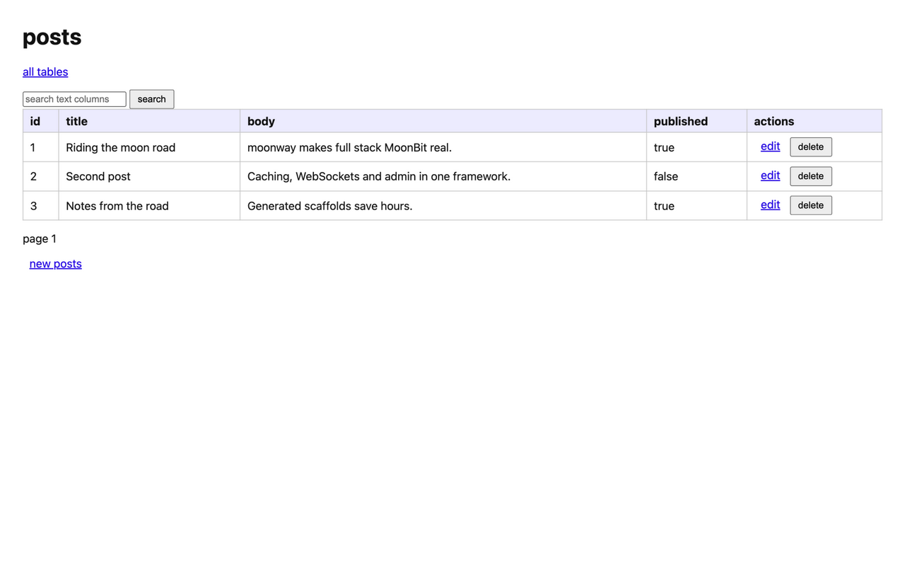

<div align="center">

# moonway

**通往月球之路。**

基于 [MoonBit](https://www.moonbitlang.com) 的全栈 Web 开发框架——路由、数据库、
缓存、WebSocket、自动生成的 admin 管理后台，一应俱全。现代 Web 应用需要的组件，
从你第一次 `moon new` 起就为彼此设计、协同工作。

[](https://github.com/daqing/moonway/actions/workflows/ci.yml) · [](LICENSE) · [English](README.mbt.md) | [简体中文](README.zh-CN.md)

</div>

## 为什么选择 moonway？

MoonBit 快、类型安全，写起来也舒服——但今天想搭一个真正的 Web 应用，你还是得自己
挑路由库、接数据库客户端、装缓存、写一堆粘合代码。**moonway** 主打「电池全含」：
一个框架把现代 Web 应用的各个组成部分整合成浑然一体，从想法到跑起来的应用只要几分钟。

名字即使命：**moon + way，通往月球之路。**

## 功能特性

- **HTTP 路由** —— 表达力强的路由定义，支持路径参数与可组合的中间件管线。
- **数据库层** —— 带迁移和流畅查询 API 的类型化数据抽象，SQLite 开箱即用。
- **缓存** —— 基于 Redis 的响应缓存，TTL 可配置（`app.cache(...)`）；
  Redis 不可用时请求照常处理，不受影响。
- **WebSocket** —— 一等公民支持，聊天、实时更新等场景信手拈来。
- **Admin 管理后台** —— 根据数据模型自动生成的 CRUD 管理界面，零前端工作量。
- **REPL 控制台** —— 交互式终端，查询数据、调试运行中的应用。
- **代码生成器** —— 为模型、处理器等生成脚手架代码，告别重复劳动。
- **templ + Preact islands** —— 生成应用将
  [moon-templ](https://mooncakes.io/docs/daqing/moon-templ@0.1.0) 服务端渲染的 HTML
  与 [Preact](https://preactjs.com) + esbuild 水合 islands 结合，在同一页面中提供有状态的交互组件。

## 快速开始

安装 [MoonBit 工具链](https://docs.moonbitlang.com)，然后：

```bash
moon new hello-moonway
cd hello-moonway
# moonway 是服务端框架：把项目切换到 native 后端
awk '{sub(/preferred_target = "wasm"/, "preferred_target = \"native\"")} 1' moon.mod > moon.mod.tmp && mv moon.mod.tmp moon.mod
moon add daqing/moonway
# 在主包里也注册依赖
printf 'import {\n  \"daqing/moonway\",\n}\n' >> cmd/main/moon.pkg
```

给你的应用加一条路由：

```moonbit nocheck
///|
fn main {
  let app = @moonway.new()
  app.get("/", ctx => ctx.text("Hello, moonway!"))
  app.listen(3000)
}
```

运行：

```bash
moon run cmd/main
```

打开 <http://localhost:3000>。月球之路，就此启程。🌙

`app.listen` 默认绑定 `127.0.0.1`。如需接受其他机器的连接，请显式使用
`app.listen(3000, host="0.0.0.0")`。

## 一个文件里的全栈

把 `cmd/main/moon.pkg` 替换为（link 参数必须写——`moon add` 不会从依赖继承；
Linux 还需要 `apt install libsqlite3-dev`，macOS 自带 SQLite）：

```json
import {
  "daqing/moonway",
  "daqing/moonway/db",
  "moonbitlang/core/json",
}

supported_targets = "native"

pkgtype(kind: "executable")

options(
  link: { "native": { "cc-link-flags": "-lsqlite3" } },
)
```

然后把 `cmd/main/main.mbt` 替换为：

```moonbit nocheck
///|
struct Post {
  id : Int
  title : String
  body : String
} derive(ToJson, FromJson)

///|
let posts : @db.Table = @db.table("posts", [
  @db.column("id", @db.IntT, primary=true),
  @db.column("title", @db.TextT),
  @db.column("body", @db.TextT),
])

///|
fn main {
  let app = @moonway.new()
  let db = @moonway.sqlite("app.db")
  if !db.migrate([@db.migration(1, "create posts", [posts.create_sql()])]) {
    abort("migrations failed")
  }
  app.get("/posts", ctx => {
    let items : Array[Json] = db.select_raw(posts, "1=1", [], limit=100)
    ctx.json(Json::array(items))
  })
  app.post("/posts", ctx => {
    let row : Json? = try {
      Some(@json.parse(ctx.body()))
    } catch {
      _err => None
    }
    match row {
      Some(Object(fields)) =>
        if db.insert_raw(posts, fields) {
          ctx.status(201).json(Json::object(fields))
        } else {
          ctx.status(500).text("insert failed")
        }
      _ => ctx.status(400).text("invalid JSON body")
    }
  })
  // 一个开箱即用的数据管理界面，挂在 /admin
  app.admin(db, [posts])
  app.listen(3000)
}
```

## SQL Builder 与 Repo

`sql` 和 `repo` 包在简洁的 `db` helper 之外，提供一套可组合的数据库 API：

- `daqing/moonway/sql` 用类型化标识符、嵌套条件、表达式、JOIN、CTE、upsert
  和命名参数构建 SELECT/INSERT/UPDATE/DELETE；`sql/sqlite`、`sql/mysql`、
  `sql/pg` 提供对应的方言 facade。
- `daqing/moonway/repo` 按出现顺序编译命名参数，应用各驱动的 SQL 转换，
  执行语句，扫描类型化模型或动态记录，并管理事务与批量关联预加载。

SQLite 沿用项目现有的 native 驱动，可直接执行。PostgreSQL 和 MySQL 当前支持
SQL 生成与 `Preview`；本包尚未内置连接这两种服务器并执行语句的网络客户端。

模型仍使用显式 `db.Table` schema 与 `ToJson`/`FromJson`，不依赖运行时反射，
也没有隐藏的命名约定：

```moonbit nocheck
struct Todo {
  id : Int
  title : String
  completed : Bool
} derive(ToJson, FromJson)

///|
let todos : @db.Table = @db.table("todos", [
  @db.column("id", @db.IntT, primary=true),
  @db.column("title", @db.TextT),
  @db.column("completed", @db.BoolT),
])

///|
fn query_todos(database : @repo.DB) -> Unit raise {
  let table = @sql.table_of("todos")
  let inserted : Todo? = @repo.insert(
    database,
    todos,
    @sql.insert(@sql.h([
      ("title", @sql.val("write more MoonBit")),
      ("completed", @sql.val(false)),
    ])).into_table(table),
  )
  let open_items : Array[Todo] = @repo.find(
    database,
    todos,
    @sql.select_fields([table.all_fields()])
    .from_table(table)
    .where_(@sql.field_eq(table.field("completed"), @sql.val(false)))
    .order_by(table.field("id").asc()),
  )
  ignore((inserted, open_items))
}
```

当查询结果不对应单个模型时，`find_maps` 返回动态
`Map[String, @sql.Value]` 记录。显式声明的 `has_one`、`has_many` 和
`belongs_to` 关联可用于 `JoinQuery` 或批量 `Preloader`。

## 生成应用：模板、islands 与 Procfile

如果既需要服务端渲染，又需要局部交互，请使用应用生成器，而不是上面最小的
`moon new` 示例：

```bash
moon install daqing/moonway/cmd/moonway
moonway new hello-moonway
cd hello-moonway
moon update
```

生成项目中与前端相关的文件如下：

```text
hello-moonway/
├── app/
│   ├── frontend/
│   │   ├── package.json          # Preact、esbuild 与 build/dev 脚本
│   │   └── src/main.jsx          # 组件、island 注册表与水合逻辑
│   └── templates/
│       ├── moon.pkg              # 引入 moon-templ 运行时
│       ├── home.templ            # 模板源文件：修改这里
│       ├── home_templ.mbt        # 生成的 MoonBit 代码：请勿手改
│       └── pages.mbt             # 向应用返回渲染后的 HTML
├── static/                       # 前端构建产物目录
├── data/                         # SQLite 数据库文件（默认 data/app.db）
├── cmd/hello-moonway/main.mbt    # 首页路由与静态文件服务
└── Procfile                      # 开发进程配置
```

### `app/templates`：服务端渲染页面

模板使用 [moon-templ](https://mooncakes.io/docs/daqing/moon-templ@0.1.0)
在服务端生成 HTML。你需要编辑 `home.templ`；`moon-templ` CLI 负责生成
`home_templ.mbt`，`pages.mbt` 则通过 `home_page` 对外提供渲染后的页面。
生成的主程序这样连接首页路由和前端资源：

```moonbit nocheck
app.get("/", ctx => ctx.html(@templates.home_page("hello-moonway")))
app.static_files("static")
```

骨架已附带 `home_templ.mbt`，因此首次编译不需要安装模板 CLI。修改 `.templ`
文件后，请让 `moon-templ` 位于 `PATH`，再重新生成：

```bash
moon-templ generate app/templates/home.templ
```

开发时也可以使用下文 `Procfile` 中的 `templ` 进程自动完成这一步。

### `app/frontend` 与 Preact islands

`app/frontend` 是一个独立的 Node.js 前端包，使用 [Preact](https://preactjs.com)
编写有状态组件，并通过 esbuild 打包。它不会把整个页面变成单页应用（SPA）：
服务端先渲染页面，Preact 随后只水合带有 `data-island` 标记的局部区域。

默认模板同时提供 island 挂载点和初始的服务端渲染 HTML：

```templ
<div data-island="counter">
  <button type="button" class="counter">Clicked 0 times</button>
</div>
<script src="/app.js"></script>
```

`app/frontend/src/main.jsx` 将 island 名称映射到组件，并水合所有匹配项。
要添加自己的 island，请定义组件、用模板中的相同名称注册，并让组件的初始
渲染结果与服务端 HTML 保持一致：

```jsx
const islands = { counter: Counter };

for (const element of document.querySelectorAll("[data-island]")) {
  const Component = islands[element.dataset.island];
  if (Component) {
    hydrate(<Component />, element);
  }
}
```

### `Procfile`：同时运行开发进程

生成的 `Procfile` 是一份开发进程配置：

```procfile
web: watchexec --restart --exts mbt --project-origin . -- moon run cmd/hello-moonway
templ: moon-templ generate --watch app/templates/...
frontend: cd app/frontend && npm install && npm run dev
```

在 macOS 上，使用 Homebrew 安装 `watchexec`：

```bash
brew install watchexec
```

在 Linux 上，可以通过 Cargo 安装：

```bash
cargo install watchexec-cli --locked
watchexec --version
```

确保 `~/.cargo/bin` 已加入 `PATH`。部分发行版也可以直接安装：

```bash
# Debian / Ubuntu（发行版软件源需提供该包）
sudo apt install watchexec

# Fedora
sudo dnf install watchexec

# Arch Linux
sudo pacman -S watchexec
```

如果发行版软件源找不到该包，推荐使用 Cargo，或从
[watchexec Releases](https://github.com/watchexec/watchexec/releases)
下载对应的 Linux 预编译版本。

确保 `moon-templ`、[watchexec](https://github.com/watchexec/watchexec)、Node.js、
npm 和 [Foreman](https://github.com/ddollar/foreman) 均位于 `PATH`，然后在项目根目录运行：

```bash
foreman start
```

- `web` 监听 `.mbt` 文件，在生成代码变更后重新编译并重启 MoonBit 服务端；
  刷新浏览器即可看到模板更新。
- `templ` 监听 `app/templates`，在 `.templ` 文件变更时重新生成 MoonBit 代码。
- `frontend` 安装 npm 依赖，并以 watch 模式运行 esbuild；前端源码变更时持续
  更新 `static/app.js`。

也可以不使用 Procfile 工具，手动构建并运行所有部分：

```bash
cd app/frontend
npm install
npm run build
cd ../..
moon run cmd/hello-moonway
```

`npm run build` 会生成 `static/app.js`，由 `app.static_files("static")` 作为
`/app.js` 提供；该构建产物已被 Git 忽略。手动构建后，前端文件每次变更都需要
重新执行 `npm run build`。未构建该文件时，服务端 HTML 仍可访问，但 `/app.js`
会返回 404，islands 也不会具备交互能力。

## 工具箱

### 代码生成器

```bash
moonway generate scaffold Post title:string body:string
```

```console
created  app/models/post.mbt
created  handlers/posts.mbt
created  migrations/001_create_posts.mbt
updated  admin registry
```

### Admin 管理后台



每个注册的数据模型都会在 `/admin` 下获得一个支持搜索、分页的 CRUD 管理界面——
增删改查数据，一行前端代码都不用写。

### REPL 控制台

```console
$ moonway console
moonway 0.11.7 · connected to sqlite://app.db
> Posts.count()
42
```

## 路线图

moonway 正在为 2026 年 10 月的 MoonBit 黑客松公开开发（最终提交：**2026 年 10 月 31 日**）。

- [x] 项目初始化——仓库、工具链、CI
- [x] HTTP 路由与中间件管线
- [x] SQLite 数据库层与迁移
- [x] 代码生成器（`moonway new`、`moonway generate`）
- [x] Redis 缓存中间件
- [x] WebSocket 支持
- [x] 自动生成的 Admin 管理后台
- [x] REPL 控制台
- [x] Preact 前端集成
- [x] 指南、示例与文档

## 参与贡献

欢迎贡献！先开一个 issue 聊聊你想做什么，也可以直接提交 pull request。

提交前请安装 git 钩子（每次提交都会自动执行格式化与测试）：

```bash
git config core.hooksPath .githooks
```

## 许可证

[MIT](LICENSE) © 2026 David Zhang
